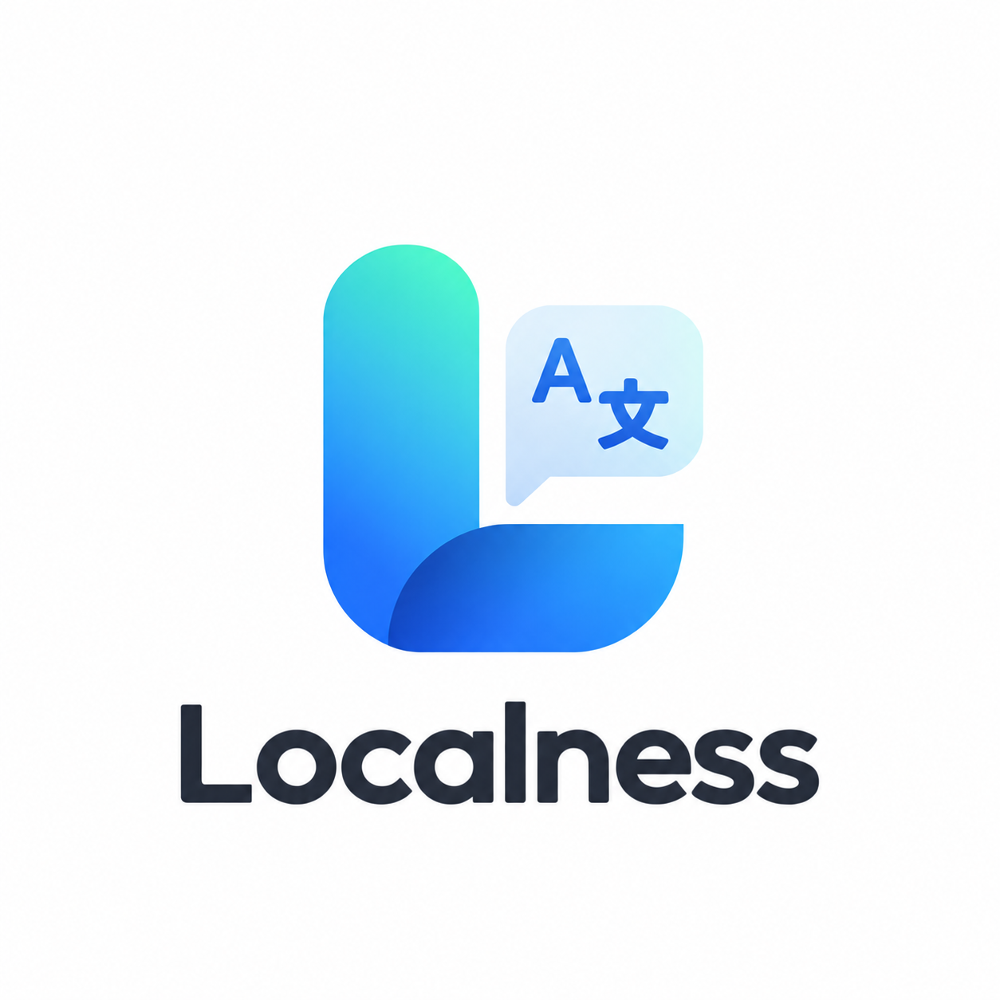
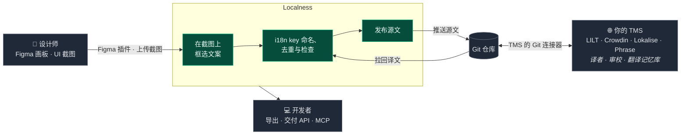

<div align="center">
  
  <h1>Localness</h1>
  <p><strong>TMS 的前一站：在 UI 截图上打标、管好你的 i18n key、把干净的源文交给翻译。</strong></p>
  <p>
    
    
    
    
    
    
  </p>
  <p><a href="README.md">English</a> · <strong>简体中文</strong></p>
</div>

---

## Localness 是什么？

Localness 是翻译管理系统（TMS）的**前一站**，服务对象是**设计师和开发者**，不是译者。

多语言的麻烦大多发生在翻译之前：文案靠人工从设计稿里抠出来，key 命名五花八门，同一句话散落在三个 key 下，译者拿到的文本也不知道出现在界面哪里。Localness 负责把这一段理顺，再把源文交给你正在用的 TMS，并把译文取回交付给开发。



### 它做什么

Localness 的核心是把三件事绑在一起：

1. **key 叫什么**：稳定、带命名空间的标识，比如 `common.submit`。
2. **出现在哪**：直接画在真实 UI 截图上的一块区域。
3. **写的是什么**：源文，以及从 TMS 取回的各语言译文。

**Page** 是上传到项目里的一张 UI 截图。你在截图上画 **Tag**，也就是框住真实界面元素的矩形。每个 Tag 绑定一个 **i18n key**，key 为项目配置的每种语言各存一份文本。其余功能都围绕这层绑定展开：

- **面向设计师**：用 Figma 插件把画板直接采集为 Page，或上传截图后用 OCR 提取文案，每条文案都带着它在界面上的位置；还能在 Figma 里预览译文，找出放不下的文字。
- **key 治理**：AI 辅助命名、命名规范、重复与一致性检查、发行标签。
- **交接**：Git 同步把源文推到 TMS 监听的仓库，再把译文拉回来；支持预览、三方合并和冲突卡片。
- **面向开发者**：导出 XLSX / JSON、由 token 保护的交付 API，以及供 AI 编程助手使用的 MCP 服务。

### 它不是什么

- **不是 TMS。** 没有译者工作台、任务分派、审校流程、翻译记忆库，也不按字数计费。这些属于你的 TMS，Localness 与它对接，而不是取代它。
- **不是 Headless CMS。** 只管 Page、Tag、key、语言和发行标签，别的都不管。
- **不是截图图库。** 一张没有 Tag 和 key 的截图只是起点。

### 草稿与发布

每份文本都有两层。编辑写入**草稿**；明确执行发布后，草稿被快照到**已发布**层。导出、交付 API 和 MCP 读的都是已发布层，所以只要不取消发布，你就可以继续改草稿，不影响已经在用的人。

**取消发布等于下线该文本，不是改草稿。** 它会清空已发布层，而不是回到旧版本；在重新发布之前，这条 key 会从导出、交付 API 和 MCP 中消失。

## 功能

- 📸 **截图优先的工作流**：把 UI 截图上传为 Page，在基于 [Leafer UI](https://www.leaferjs.com/) 的画布编辑器里标注。可以画框、缩放、移动、锁定、调整顺序，支持撤销 / 重做。
- 🖌️ **Figma 插件**（`localness-plugin`）：**Capture** 把 Figma 画板变成一个 Page，包括截图、每个文本图层一个 Tag 和源文，并自动匹配已有 key；**Preview** 在画板旁排出已发布的各语言译文，标出可能溢出的图层。插件通过交付 API 和个人访问 token 连接实例，实例必须走 HTTPS。
- 🔤 **OCR 辅助**：识别 Tag 区域内的文字（[OCR.Space](https://ocr.space/) API），预填源文。
- 🤖 **AI 辅助命名 key**：根据 Tag 上下文，通过任意兼容 OpenAI 的接口建议 key 名；可按功能单独配置。
- 🌐 **词条表**：左栏按 key 和原文列出词条，用圆点显示各语言覆盖情况；右栏是选中词条的详情——截图上下文、原文、各语言译文（自动保存）、发行标签和 Git 同步。支持批量发布、导入，以及给占位 key 用 AI 起名。
- 🧹 **一致性检查**（Plus）：扫描项目里不同 key 下的重复原文、占位符 / 数字 / 标签与源文对不上的译文、风格问题和无人引用的 key，并在评审抽屉里逐条修复。
- 🏷️ **发行标签（Release）**：给 key 打上类似版本号的标签（如 `v1.3`、`sprint-12`），在词条表、导出和交付 API 中按标签筛选。
- 📦 **导出**：下载 XLSX（含一张在原截图上画出 Tag 的预览表）或 JSON（扁平结构，或按 i18n 框架分层）。
- 🔁 **Git 同步（交接给 TMS）**：把源文推到 TMS 读取的 Git 仓库，再把译文拉回来；支持预览、三方合并和界面化的冲突处理。内置 LILT 批次布局和通用的「每种语言一个 JSON」布局，其他布局可以按 adapter 扩展（见 [`server/libs/git-sync/README.md`](server/libs/git-sync/README.md)）。
- 👥 **团队与权限**：邀请码加入团队，owner / editor / viewer 角色，每个项目有自己的 owner。
- 🔌 **交付 API 与 MCP**：`v1` API（`projects` / `meta` / `locales/:locale` / `bundle`，另有一组供设计工具导入画板的写接口），由个人访问 token 保护；MCP 服务让 AI 编程助手直接查询 key。
- 🧩 **Skills**：挂载项目知识包，AI agent 通过 API / MCP 使用。
- 🔔 **通知**：团队邀请和协作事件的站内通知。
- 🔐 **认证**：本地用户名 / 密码账号（scrypt 哈希），可选 Atlassian OAuth，并按邮箱域名白名单限制。
- 🗄️ **可插拔的图片存储**：截图存本地卷，或使用七牛云 OSS。
- 🌙 **深色优先的界面**：基于 Nuxt UI 和 Tailwind CSS 4。

## 技术栈

| 层级     | 技术                                                                   |
| -------- | ---------------------------------------------------------------------- |
| 框架     | Nuxt 4（Vue 3、TypeScript）+ Nitro 服务端                              |
| UI       | Nuxt UI、Tailwind CSS 4、motion-v、Leafer UI 画布                      |
| 状态     | Pinia                                                                  |
| 数据库   | SQLite，经 Prisma 7 + better-sqlite3                                   |
| 认证     | nuxt-auth-utils（session + scrypt），可选 Atlassian OAuth 2.0（3LO）   |
| 校验     | zod（前后端共用 schema）                                               |
| 测试     | Vitest（单元 + API）                                                   |
| 打包部署 | pnpm workspaces、Docker（单容器 + 一个数据卷）                         |

## 目录结构

```text
app/                  Nuxt 前端（页面、组件、composables、stores、编辑器内核）
server/               Nitro 后端
  api/                REST 接口（pages、tags、translations、teams、projects、v1 交付）
  routes/             认证路由、文件上传、MCP 端点
  helper/             权限、token、i18n、发行标签、git-sync 辅助
  libs/               Prisma 客户端、OCR、AI agent、git-sync 引擎、存储驱动
shared/               前后端共用的类型、常量、zod schema 和工具函数
prisma/               SQLite schema 与迁移
test/                 Vitest 单元测试与 API 测试
docker/               Docker 入口脚本与部署指南
docs/run-book/        完整产品手册（中文）
runtime/              数据目录：SQLite 数据库与本地上传文件
```

## 本地开发

**前置条件：** Node.js ≥ 22（见 `package.json` 的 `engines`）和 pnpm 10（`corepack enable && corepack install`）。

```bash
# 安装依赖
pnpm install

# 准备数据库（SQLite 文件位于 runtime/db）
pnpm exec prisma generate
pnpm exec prisma migrate deploy

# 启动开发服务器：http://localhost:3000
pnpm dev
```

**没有公开注册入口**：第一个用户以及之后的所有用户都通过命令行创建：

```bash
pnpm register
```

## 脚本

| 命令              | 说明                                         |
| ----------------- | -------------------------------------------- |
| `pnpm dev`        | 启动 Nuxt 开发服务器                         |
| `pnpm build`      | 生产构建                                     |
| `pnpm preview`    | 本地预览生产构建                             |
| `pnpm lint`       | ESLint 检查                                  |
| `pnpm typecheck`  | `nuxi typecheck`（vue-tsc）                  |
| `pnpm test`       | 运行单元 + API 测试（Vitest）                |
| `pnpm test:unit`  | 只跑单元测试                                 |
| `pnpm test:api`   | API 测试（在 `:4000` 启动完整 Nuxt 实例）    |
| `pnpm register`   | 通过命令行创建用户账号                       |

CI（GitHub Actions）以 `pnpm test` 和 `pnpm typecheck` 作为门禁。

## 部署（Docker）

Docker 是唯一支持的部署方式：一个容器加一个数据卷（`/app/runtime`），卷里存放 SQLite 数据库，以及使用 `LOCAL` 存储时上传的截图。**卷丢了，数据就丢了。**

```bash
# 在 docker-compose.yml 同级目录：
cp .env.docker.example .env.docker
# 编辑 .env.docker —— NUXT_SESSION_PASSWORD（32 位以上）必填

docker compose pull
docker compose up -d
docker compose logs -f localness     # 迁移会在服务启动前执行

# 创建第一个账号
docker compose exec localness tsx scripts/register.ts
```

- 入口脚本每次启动都会执行 `prisma migrate deploy`（幂等）。
- 健康检查：`curl localhost:13000/api/health` → `{"ok":true,"db":true,...}`。
- 固定版本而不是用 `latest`：
  `LOCALNESS_IMAGE=huacc/localness:1.2.0 docker compose up -d`
- 推送 semver 格式的 git tag 后，镜像会发布到 Docker Hub（`huacc/localness`）。

完整部署指南（用 `update.sh` 升级、备份与恢复、挂载 AI prompt、配置 Atlassian OAuth）见 [`docker/README.md`](docker/README.md)（英文）。

## 配置

所有配置都来自环境变量；Docker 下来自 `.env.docker`（不会打进镜像）。常用项如下，完整列表见 [`.env.docker.example`](.env.docker.example)：

| 变量                                        | 用途                                                       |
| ------------------------------------------- | ---------------------------------------------------------- |
| `NUXT_SESSION_PASSWORD`                     | **必填。** session 加密密钥，32 位以上                     |
| `NUXT_SALT_SIZE`                            | scrypt 盐长度，也是构建参数；上线后不要再改                |
| `DATABASE_URL`                              | SQLite 文件 URL（默认 `file:/app/runtime/db/localness.db`）|
| `PORT`                                      | 监听端口（默认 `13000`）                                   |
| `NUXT_PUBLIC_OSS_ENGINE`                    | 截图存储：`LOCAL` 或 `QINIU`                               |
| `NUXT_PUBLIC_OSS_BASE_URL`                  | 图片的公开访问前缀（`LOCAL` 时为 `/upload/`）              |
| `NUXT_QINIU_*`                              | 七牛 OSS 的凭据、空间和域名                                |
| `NUXT_OPENAI_API_KEY` / `BASE_URL` / `MODEL`| AI 功能共用的 OpenAI 兼容接口                              |
| `NUXT_OPENAI_I18N_KEY_*`                    | key 命名 AI 的单独配置                                     |
| `NUXT_OCR_API_KEY` / `NUXT_OCR_API_URL`     | OCR.Space 配置                                             |
| `NUXT_OAUTH_ATLASSIAN_*`                    | 可选的 Atlassian OAuth 客户端                              |
| `NUXT_ATLASSIAN_ALLOWED_EMAIL_DOMAINS`      | 邮箱域名白名单，留空表示拒绝所有人                         |

## 面向调用方的 API 与 MCP

已发布的译文以只读方式对外提供，由个人访问 token 保护。token 会写明它能访问哪些项目；每次请求都会按 token 所有者当前的团队成员身份重新校验，所有者离开团队后 token 随即失效：

- `GET /api/v1/projects`：这个 token 能访问哪些项目
- `GET /api/v1/meta`：项目元数据、语言、发行标签
- `GET /api/v1/locales/:locale`：某种语言的全部已发布 key
- `GET /api/v1/bundle`：完整的已发布数据包

如果一个 token 只能访问一个项目，请求里无需指定项目。token 改为个人所有之前签发的旧 token 都属于这种情况，所以这些调用方不需要任何改动。

MCP 端点（`/mcp?project=<id-or-name>`）把同样的数据提供给 AI 编程助手。详见 [`docs/run-book/12-api-mcp.md`](docs/run-book/12-api-mcp.md)。

## 文档

- [`docker/README.md`](docker/README.md)：部署、升级、备份、OAuth、AI prompt（英文）
- Figma 插件（`localness-plugin`）：安装、连接、Capture 与 Preview 的说明随插件提供，插件暂未公开
- [`docs/run-book/`](docs/run-book/00-menu.md)：完整产品手册，涵盖团队、项目、发行标签、编辑器、词条表、导出、Git 同步、API / MCP、Skills、权限

## 许可证

**[Elastic License 2.0](LICENSE)**：源码可见（source-available），不是 OSI 认可的开源许可证。

Copyright (c) 2026 CHUANCHENG HUA（[@Hwacc](https://github.com/Hwacc)）。

你**可以**免费：

- 自己运行 Localness，个人使用或在公司内部使用，包括生产环境；
- 阅读、修改和构建源码；
- 再分发，只要接收方同时拿到许可证条款。

你**不可以**：

- 把 Localness 作为托管服务或代管服务提供给第三方，也就是当作 SaaS 转售；
- 移动、修改、禁用或绕过许可证密钥功能，或移除任何受许可证密钥保护的内容；
- 删除或遮挡许可证与版权声明。

如果你修改了源码，副本中必须显著注明。以上摘要不能替代具有约束力的 [`LICENSE`](LICENSE) 原文；如有出入，以原文为准。

如需解除上述限制的商业许可，或有其他许可相关问题，请联系 **mshcccch@gmail.com** 或提交 issue。
