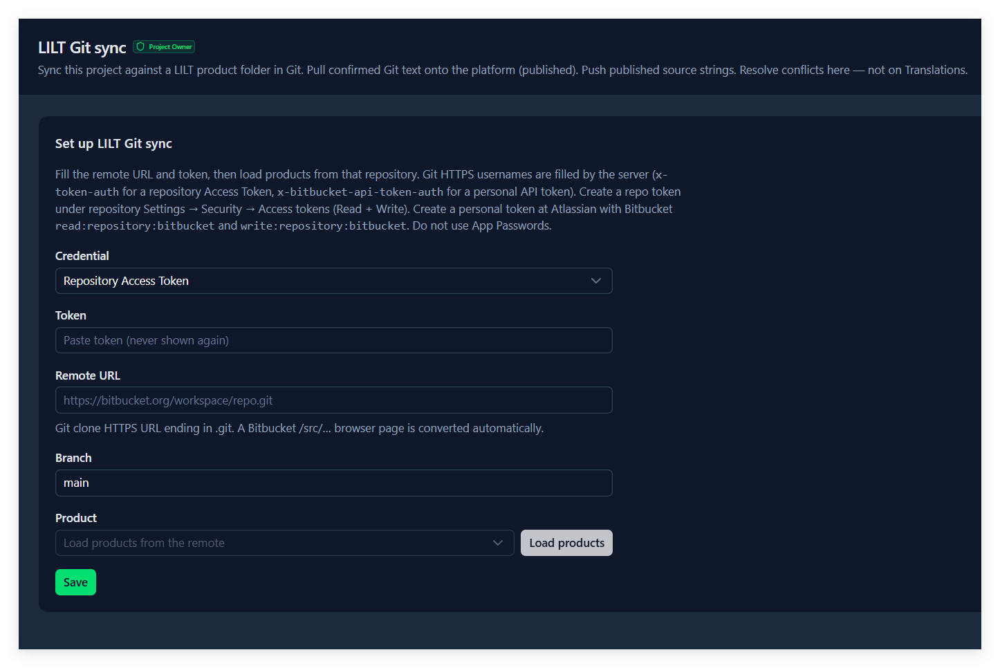
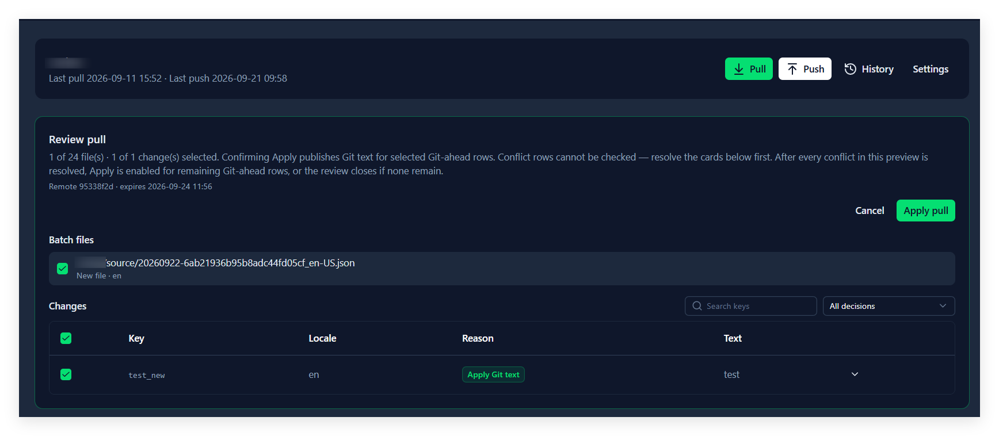
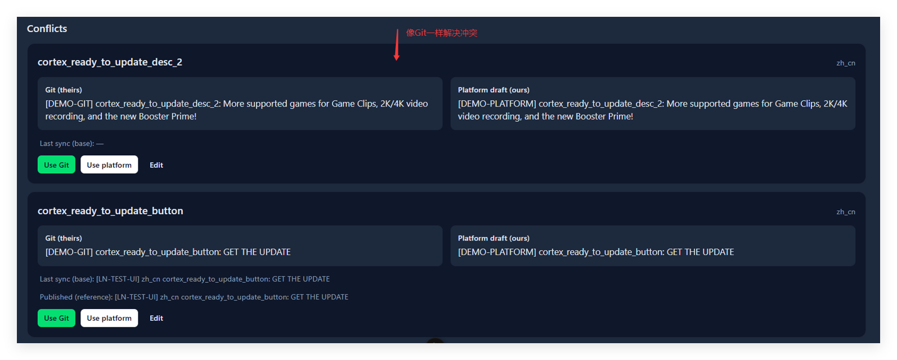

# 11. Git 同步

## 这一章能做什么

- 把项目和 Git 仓里存放语言文件的地方绑起来：LILT 的 product 目录，或者应用仓里的一个 locale 目录
- **Pull**：把 Git 上领先的文案落到平台上
- **Push**：把平台的已发布源语言推到远端（LILT 是一个新批次文件，Locale files 是原地改源语言文件）
- 处理冲突卡片
- 查同步历史

## 这一页在哪

左侧栏的 **Git sync**。页头写着 **Git sync** 和这句话：

> Sync this project against locale files in a Git repo. Pull confirmed Git text onto the platform (published). Push published source strings. Resolve conflicts here — not on Translations.

**同步的事全在这一页做**，词条表上不出现任何 Git 操作。

还没绑定时：

- 你**不是**这个项目的 Project Owner：一条警告，`Git sync is not configured` / `Contact a Project Owner to configure Git sync.`
- 你是 Project Owner：直接是这个项目的绑定表单。

## 绑定（Project Owner）

表单前四项是连接，后面是**布局（Layout）**，决定仓里的文件怎么读写：

| 字段                 | 说明                                                                                                                                                                    |
| -------------------- | ----------------------------------------------------------------------------------------------------------------------------------------------------------------------- |
| **Credential** | **Repository Access Token**（仓级令牌）或 **Personal API token**（个人令牌）                                                                                |
| **Token**      | 粘进去就行，占位文字写着`Paste token (never shown again)`——**存下之后再打开这一页是看不到的**，所以要换只能在 **Rotate token** 里粘一个新的             |
| **Remote URL** | 必须是**HTTPS 的 clone 地址**（以 `.git` 结尾）。帮助文字：`Git clone HTTPS URL ending in .git. A Bitbucket /src/… browser page is converted automatically.` |
| **Branch**     | 默认`main`                                                                                                                                                            |
| **Layout**     | **LILT product folder**（只增不改的批次文件）或 **Locale files**（每个语言一个 JSON，原地更新）                                                                    |
| **Product**    | 仅 LILT：这个仓里哪个 product 目录。先点**Load products** 才会列出候选                                                                                                |
| **Directory**  | 仅 Locale files：放语言文件的目录，相对仓根，比如 `src/locales`。手填，没有 Load 按钮                                                                                   |
| **File pattern** | 仅 Locale files：文件名模板，必须含一次 `{locale}`、以 `.json` 结尾。默认 `{locale}.json`，也可以是 `{locale}/messages.json`                                         |
| **Format**     | 仅 Locale files：**Nested JSON**（`{ "home": { "title": … } }`）或 **Flat JSON**（`{ "home.title": … }`）。只影响文件里还没有的 key 写成什么样                         |

**粘浏览器地址不用自己改**：在 Bitbucket / GitHub 上打开目录时地址栏里那种 `/src/main/…` 或 `/tree/main/…` 的链接，离开输入框时会自动变成 `.git` 结尾的 clone 地址，顺带把里面的分支填进 **Branch**。

**Load products 需要先有 token**（输入框里粘了，或者之前存过）。没有 token 时按钮是灰的，下面写着 `Paste a token to enable Load products. Listing products clones the remote.`——它真的会去 clone 一次，所以有点慢。

列出的是这个仓里**带 `source/` 或 `translated/` 的目录**，选定一个，点 **Save**。

绑定好之后，卡片上显示 product 名字、`Last pull <时间> · Last push <时间>`（从没同步过写 `Never`），右上角是 **Pull** / **Push** / **History** / **Settings**。同一张卡片里 Settings 展开后就是这套字段外加一个 **Rotate token (leave blank to keep)**，改完点 **Save settings**。

**一个项目只能绑一处**，换地方就是在 Settings 里改。切换 Layout 会清空 Product / Directory，要重新选或填。

绑好之后卡片标题：LILT 显示 product 名字；Locale files 显示 `目录/文件模板`，比如 `src/locales/{locale}.json`。

## 远端长什么样

### LILT product folder

```
<product>/source/<YYYYMMDD>-<批次 id>_<源语言>.json
<product>/translated/<同一个前缀>_<目标语言>.json
```

两边都是**扁平 JSON**（`{ "key": "文案" }`），而且**只增不改**：一次 Push 就是往 `source/` 里放一个**新文件**，只装这次推上去的那些 key，不重写老文件。下游写出 `translated/` 时会把前缀原样带过来，只换语言那一段。

远端 locale 用的是带地区的写法（`en-US`、`de-DE`），平台的代码是短的（`en`、`de`），中间有一张默认对照表，认不出来的时候，Pull 的文件列表里会写成 `unmapped (de-DE)`，这种文件不参与这次 Pull。

### Locale files

```
<目录>/<文件模板，{locale} 换成语言>      比如 src/locales/en.json、src/locales/zh-CN.json
```

- **按项目的语言去找文件**：项目语言 `zh_cn` 对应文件名 `zh-CN`，`en` 就是 `en`（下划线换成连字符、地区大写）。目录里多出来的、不对应任何项目语言的文件**不读**。
- 文件可以是嵌套的，也可以是扁平的，**混着写也行**：嵌套对象用 `.` 拼成 key（`home.title`），和 Translations 导入同一个规则。允许注释和尾逗号。
- **Push 只改源语言那一个文件，原地改**：已有的 key 在原位置改值；新 key 追加到所属对象的末尾。**key 顺序、缩进、注释、换行符都保持不动**，所以 diff 只有改到的那几行。文件不存在就新建（连同模板里的子目录）。
- 译文文件由下游（翻译平台或开发）改，平台只读。
- 这种布局**不记录译文是翻哪一版源文的**，所以 Pull 里不会出现 **Older source** 徽章。
- 源语言文件不是合法 JSON 时，Pull / Push 会直接报错并写明是哪个文件，不会覆盖它；译文文件坏了只是跳过那个文件。

## Pull：先预览，再落地

点 **Pull** 不会直接改任何东西，先出一块 **Review pull** 面板：

- 标题下面写着这次的范围：`3 of 5 file(s) · 8 of 12 change(s) selected.`
- `Remote <commit 前 8 位> · expires <时间>`——预览有有效期，过期要重新拉。

**Files**：这次涉及的远端文件，一条一个勾选框，后面写着来源和对应的平台语言（`New file` / `Content changed` / `Already pulled`）。**不勾的文件不会落地，下次 Pull 还会是候选**，不会被悄悄标记成「看过了」。

**Changes**：逐条 key 的变更，列是 **Key** / **Locale** / **Reason**（裁决结果）/ **Text**（Git 那边的文案）。可以按 key 或文案搜，也可以按裁决筛。展开一行能看到 **Git** 和 **Platform draft** 两份文案对照。



裁决只有四种，含义是拿「上次同步的基线」比的：

| 界面上写的                    | 意思                        | 能不能勾                     |
| ----------------------------- | --------------------------- | ---------------------------- |
| **Apply Git text**      | 只有 Git 改了，平台这边没动 | 能勾，这是唯一能勾的一种     |
| **Keep platform draft** | 只有平台改了，Git 没动      | 不能勾，本来就不会动它       |
| **Align base only**     | 两边一样                    | 不能勾，只是把基线记上       |
| **Conflict**            | 两边都改了，而且不一样      | 不能勾，去下面的冲突卡片处理 |

勾完点 **Apply pull**：

- **Apply Git text** 的行会把 Git 的文案写进平台，**草稿和已发布一起写**——Pull 下来的东西当场就是已发布状态，能直接导出、能被 API 取到。
- **Align base only** 只记基线，不改文案。
- 落地完提示 `Published 5, kept 2, conflicts 0, files 3`。

**Older source（黄色徽章）**

（只有 LILT 布局会出现。）这条译文翻的是一句**已经被改过的旧源文**。典型场景：
1. 源文改过以后又 Push 了一批；
2. LILT 先交回了上一批的译文；
3. 新那一批还在翻。

这种行**默认不勾**，勾文件、全选也不会带上它。展开能看到「Translated from (older source)」，也就是它当初翻的那句源文。

真要先用它，可以手动勾上。落地后，这条译文在 Translations 里显示为过期（Outdated），等新批次的译文回来后，下次 Pull 会正常覆盖。

如果同一条译文在平台上也改过，它会变成冲突卡片。卡片上会出现黄色提示「Git's text translates an older source」，并写明它当初翻的源文：
- 选 **Use Git**：落地后同样显示为过期；
- 选 **Edit** 并保存你改过的文本：视为已按当前源文处理，不显示过期。

**有没解决的冲突时 Apply pull 是按不动的**，先把卡片处理掉。

**远端在你预览之后又变了**（别人推了一版），点 Apply 会告诉你 `Remote changed since preview — run a new preview`，这次预览作废，重新点一次 Pull。

## Push：先预览，再提交

点 **Push** 同样先出 **Review push** 面板：

> `3 of 7 source key(s) selected (en). Nothing is committed until you confirm. Git-ahead keys stay on Git unless you check them (overwrites Git). Both-changed keys cannot be checked — use the conflict cards below.`

推的是**已发布的源语言**文案。每条 key 有一个原因：

| 原因                                         | 意思                                                     | 默认勾选       |
| -------------------------------------------- | -------------------------------------------------------- | -------------- |
| **New key**                            | 远端还没有这条 key                                       | 是             |
| **Changed**                            | 平台改过，Git 那边没动                                   | 是             |
| **Unchanged since last push**          | 和远端一样，没什么可推                                   | 否，默认不显示 |
| **No published source text**           | 这条 key 的源语言还没发布                                | 否，默认不显示 |
| **Auto draft key**                     | `__draft_` 占位 key，永远不推                          | 否，默认不显示 |
| **Cannot be written — clashes with an existing key path in the file** | 仅 Locale files：这条**新** key 在文件里放不下。比如文件里 `home` 是一句文案，新 key `home.sub` 就没地方写；或者 `home` 和 `home.sub` 两个新 key 互相冲突（两条都不写）。改 key 名或改 Format | 否，不能勾 |
| **Git is ahead — check to overwrite** | Git 那边改了而平台没动。**勾上就是用平台覆盖 Git** | 否，但可以勾   |
| **Conflict with Git source**           | 两边都改了，不能勾，去冲突卡片                           | 不能勾         |

上面那张表里写「默认不显示」的几种，要用右上角的原因筛选专门挑出来才看得到；默认视图只给你**要推的**和**要你决定的**。

展开一行能看到 **Published source**（平台要推的）、**Git source**（远端现在的）和 **Last pushed**（上次推的是什么）。

点 **Commit push** 之后，LILT 远端多出一个增量批次文件；Locale files 则是源语言文件被原地更新。提示是：

- 成功：`Push finished` / `5 keys → 20260923-6aa26c2e542cd9280fae24da_en-US.json`（Locale files 是 `5 keys → en.json`）
- 有跳过的：后面跟一句 `· 2 skipped`；有冲突的跟 `· 1 conflict(s)`（标题变黄）
- 没有可推的：`Nothing to push`
- 远端其实已经有一模一样的批次了：`Already on Git — records updated` / `3 keys had already landed; platform records are now in sync`

**有没解决的冲突时，连 Push 按钮本身都按不动**（卡片上方会写着 `N open conflict(s). Resolve the cards below before Apply pull or Push.`）。

## 冲突卡片

**冲突就是同一条 key 的同一种语言，Git 和平台两边都改了，而且改得不一样。** 每次都发生在预览的时候——只要你点过 Pull 或 Push 的预览，有冲突就出现在页面下方的 **Conflicts** 区，没冲突时那里写着 `No open conflicts.`

一张卡片长这样：

- 上面是 key 和语言。
- 左边 **Git (theirs)**，右边 **Platform draft (ours)**，两份文案摆在一起对照。
- 底下 **Last sync (base)**：上次同步时这条的文案——判断「谁改了」就看它。
- 有时候还有一行 **Published (reference)**：平台上已发布的那份，用来参考。

四个按钮，选完这条就关掉：



| 按钮                                      | 结果                                                                                             |
| ----------------------------------------- | ------------------------------------------------------------------------------------------------ |
| **Use Git**                         | 采用 Git 的文案，写进平台草稿                                                                    |
| **Use platform**                    | 保留平台这边的文案                                                                               |
| **Edit** → **Save edit**     | 两边的都不满意，自己改一版写进去                                                                 |
| **Rename…** → **Keep both** | 平台上这条 key 改名并**退出 Git 同步**，Git 那边原地不动。适合「这边想另起一个 key」的情形 |

三件事要知道：

- **裁决写的是草稿。** 想让它进导出、进 API、进下一次 Push，回词条表**发布**一次。
- **裁完之后再 Pull 不会又弹一次这张卡。** 系统把「上次同步的基线」记在 Git 那一侧，所以下次 Pull 看到的是 **Keep platform draft**，不是 **Apply Git text**——它不会把你的选择再覆盖回去。
- **Rename 之后平台上那条 key 不再参与 Git 同步**。输入框下面写着这句话：`The platform's key moves to that name and leaves Git sync. Git's copy of <key> stays where it is.`

## 单独把一条 key 排除在同步外

词条表里每行第一个图标就是 **Git 同步开关**（第 9 章）。关掉的 key：

- **Pull 和 Push 都不带它**，Push 的预览列表里根本不会出现。
- 它照样从已发布 API 里取得到——排除的是同步，不是发布。
- 如果 Git 那边和它不一致，还是会冒出一张冲突卡片让你决定，不会被静默丢掉。

## 历史

**History** 打开 **Git sync history**：

> What Pull, Push and conflict resolution actually did.
> Previews are not recorded — only runs that landed something.

每条一行：动作（**Pull** / **Push** / **Conflict**）、状态（**Success** / **Partial** / **Refused** / **Failed**）、一句摘要（比如 `5 key(s) applied · 2 aligned · 3 file(s)`）、commit 前 7 位、操作人、时间。展开能看到明细。行多的时候点 **Load more**。

## 做错了会怎样

| 你看到                                                | 原因                                                                                                    |
| ----------------------------------------------------- | ------------------------------------------------------------------------------------------------------- |
| `Git sync is not configured`                        | 这个项目还没绑定。找 Project Owner                                                                      |
| **Load products** 是灰的                        | 还没粘 token。列 product 会 clone 一次远端，所以必须先有凭证                                            |
| 提示`Remote URL must be an https Git remote`        | 地址不是 HTTPS，或者解析不出仓名。Bitbucket / GitHub 的浏览地址会被自动转，转不出来就说明这条链接不是仓 |
| **Push** 按钮按不动                             | 还有没解决的冲突卡片                                                                                    |
| **Apply pull** 或 **Commit push** 是灰的  | 一条都没勾；或者这次预览里还有冲突没解决                                                                |
| `Remote changed since preview — run a new preview` | Pull 的预览之后别人又推了一版。重新点一次 Pull 拿新预览                                                 |
| `Remote changed during push — run a new preview`   | Push 提交的一瞬间别人也在推同一个分支。重新点一次 Push                                                  |
| 预览过期了                                            | 预览有有效期，过期重新点一次                                                                            |
| 裁决完冲突，Push 里还是没有它                         | 裁决写的是草稿，要先在词条表**发布**，下次 Push 才会带上                                          |
| 裁完冲突再 Pull，那张卡又回来了                       | 不该发生。真出现说明中间有人又改了 Git 那边——重新看一遍卡片上的两份文案                               |
| 想换 product，下拉里只有当前那一个                    | 候选是**Load products** 现列出来的，换之前再点一次 **Load products**                        |
| Pull 的下拉里某个文件写着`unmapped (de-DE)`         | 远端这个语言在平台的对照表里找不到，这个文件不参与 Pull                                                 |
| 词条表里某条 key 不出现在 Push 预览里                 | 它的 Git 同步开关关着（第 9 章），或者它是个`__draft_` 占位 key                                       |
| Pull 下来的文案马上就出现在导出里了                   | 正常，Pull 的**Apply Git text** 写的是草稿 + 已发布                                               |
| 远端`translated/` 里的语言一直不更新                | 那一侧由下游（LILT）写，平台只推`source/`                                                             |
| Locale files：Push 预览里有 **Cannot be written**     | 新 key 和文件里已有的结构撞了（见上面 Push 原因表）。改 key 名，或者换 Flat JSON                         |
| Locale files：Pull 里少了某个语言                     | 文件名对不上。确认文件叫 `zh-CN.json` 这种写法，并且项目里有这个语言                                    |
| Locale files：`Directory must be a relative path…`  | 目录要写相对仓根的路径，不能以 `/` 开头、不能有 `..`                                                     |
| Locale files：没有 **Load products** 按钮           | 正常。目录手填，任何文件夹都可能放语言文件，没法替你列                                                  |

> 自部署时想接入其他 TMS 的仓库布局：见源码 `server/libs/git-sync/README.md`。
