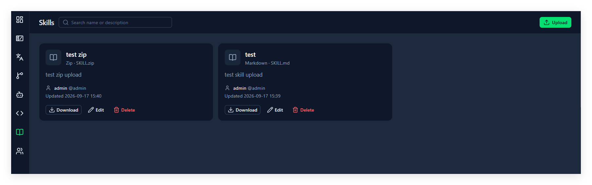

# 13. Skills

## 这一章能做什么

- 按项目存放给 agent 用的 skill 包
- 上传、下载、改名字和说明、换掉包里的文件、删除
- 按名字或说明搜
- 标注 skill 适用哪些 agent（**Works with**），并按 agent 筛选

## 这一页在哪

左侧栏的 **Skills**。页头一行：标题 **Skills**、搜索框（`Search name or description`）、agent 筛选（默认 **All agents**）、右边的 **Upload**。下面是卡片网格，一个 skill 一张卡。

- 还没选项目：`Select a project to share skills with the team.`
- 项目里一个都没有：`No skills yet. Upload a zip with SKILL.md, or a single markdown file.`

## 上传一个 skill

点 **Upload**，弹窗标题 **Upload skill**，三项：

| 字段                  | 说明                                                                                                                               |
| --------------------- | ---------------------------------------------------------------------------------------------------------------------------------- |
| **Name**        | 必填，项目里唯一。占位文字是`i18n-assistant`                                                                                     |
| **Description** | 必填。占位文字是`When to use this skill`——写清楚 agent 什么时候该用它                                                          |
| **Works with**  | 可选，多选。见下面「Works with」                                                                                                   |
| **Package**     | 选文件。底下那行说明就是全部要求：`Zip or .skill with SKILL.md at the root (or one folder down), or a single .md file. Max 5MB.` |

底部 **Cancel** / **Upload**。

### Works with

下拉里的选项：

- **General**：任何 agent 都能用。选了它，其他选项全部变灰；已选的其他项会被清掉。
- 预设：**Claude Code**、**OpenAI Codex**、**GitHub Copilot**、**Cursor**、**Gemini CLI**、**Hermes Agent**。
- **Custom**：勾上后下面出现 **Custom agents** 输入框，输入名字按回车添加。每个最多 24 个字符，最多 5 个，右上角显示 `n/5`。取消勾选 **Custom** 会清空已填的名字。

自定义名字如果就是某个预设（比如输入 `cursor`），保存时自动变成那个预设；大小写不同的重复名字只留一个。不选任何项也可以，卡片上就不显示。

选文件时会当场检查，不合格直接说原因：

| 提示                                                         | 原因                       |
| ------------------------------------------------------------ | -------------------------- |
| `Use a .zip, .skill, or .md file`                          | 文件类型不对               |
| `File must be 5MB or smaller`                              | 超过 5 MB                  |
| `Zip must contain SKILL.md at the root or one folder down` | 压缩包里找不到`SKILL.md` |

## 卡片上有什么

- 名字，和一行 `类型 · 原文件名`（类型按扩展名认：**Markdown** / **Skill bundle** / **Zip** / **Package**）。
- 说明，最多显示三行。
- **Works with** 区：说明下方一条分隔线，每个 agent 一枚 logo + 名字的标签，全部列出、放不下就换行。没标注就没有这一块。
- **维护人**：头像旁边的名字，以及 `@用户名`。
- `Updated <时间>`。
- 三个按钮：**Download**、**Edit**、**Delete**。

## 谁能改哪一条

**只有上传它的人能改和删。** 别人传的卡片上不出现 **Edit** 和 **Delete**，只有 **Download**——服务端也是这条规则，界面上看不到入口而已（硬试会回 `Only the skill maintainer can change it`）。

**每个 Team Member 都能上传。** 上传不需要 Project Owner 权限，和建词条一样是内容工作。

- **Edit** 打开 **Edit skill**：改 **Name**、**Description**、**Works with**，以及 **Replace package**（不选文件就只改文字）。
- **Delete** 确认框：`Delete “<名字>”? The package file is removed too.`——**包文件一起删掉**。
- 名字重复会被拦下：`A skill with this name already exists in the project`。同一个项目里名字唯一，跨项目互不影响。

## 做错了会怎样

| 你看到                                                                 | 原因                                                            |
| ---------------------------------------------------------------------- | --------------------------------------------------------------- |
| 卡片上没有**Edit** 和 **Delete**                           | 这条不是你传的。要改找维护人                                    |
| 上传时提示`Use a .zip, .skill, or .md file`                          | 只收这三种扩展名                                                |
| 上传时提示`Zip must contain SKILL.md at the root or one folder down` | 压缩包里没有`SKILL.md`，或者埋得太深                          |
| 提示`File must be 5MB or smaller`                                    | 超过 5 MB                                                       |
| 保存时提示`A skill with this name already exists in the project`     | 换个名字。同名指的是同一个项目内                                |
| 搜不到刚传的 skill                                                     | 搜索只匹配名字和说明；也可能当前项目不是你以为的那个（第 4 章） |
| 换个项目后列表空了                                                     | skill 是**按项目**存的，切项目就换一批                    |
| 选了某个 agent 后，没标注的 skill 不见了                               | 筛选只留标了这个 agent 的，以及标了 **General** 的。切回 **All agents** 看全部 |
| 筛选显示`No skills work with this agent.`                            | 当前项目没有 skill 标了这个 agent（也没有 **General** 的）     |
